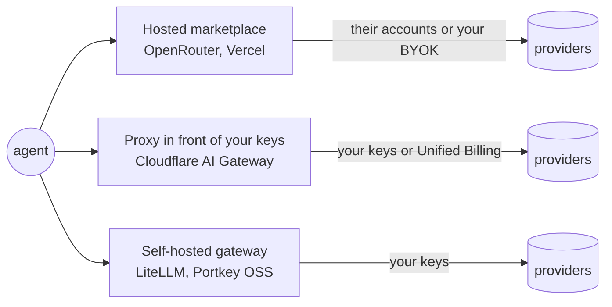

An LLM gateway sits between your agents and the model providers. Your code talks to one endpoint, and the gateway handles keys, routing, retries, caching, logging and spend limits. For agents that loop dozens of times per task, it is where you stop runaway costs and survive a provider outage without code changes.

This page is about **model traffic**. To put one controlled endpoint in front of many *MCP tool servers*, see [MCP gateways compared](comparison:mcp-gateways). Two of the gateways here (Portkey and LiteLLM) now do both.

## Three kinds of gateway

- **Hosted marketplaces** ([OpenRouter](entry:openrouter), [Vercel AI Gateway](entry:vercel-ai-gateway)) sell you tokens from many providers on one bill. Both say they charge provider list prices with no markup per token. OpenRouter charges a fee when you buy credits (5.5% or 8%). Vercel charges for optional add-ons. Both also accept your own provider keys (BYOK).
- **Cloudflare AI Gateway** ([entry](entry:cloudflare-ai-gateway)) is mainly a proxy for the provider accounts you already have, with free analytics, caching and rate limiting. It now also offers Unified Billing (5% fee on credits) if you'd rather not hold provider accounts.
- **Self-hosted gateways** ([LiteLLM](entry:litellm-mcp-gateway), the open-source [Portkey](entry:portkey-ai-gateway) gateway) run in your infrastructure with your keys. You get virtual keys, budgets and logs without sending prompts through a third party, but you run the database and the uptime.

## What matters for agents

**Fallback that doesn't bill you twice.** Agent loops hit rate limits. OpenRouter retries other models from a `models` array and says failed attempts aren't charged. Vercel records every routing attempt in its request logs. Cloudflare, Portkey and LiteLLM all have configurable retries and fallbacks.

**Hard spend caps.** Budgets come in different shapes. Vercel budgets apply per team, project, API key or member, but only to spend on Vercel's own credentials: BYOK spend doesn't count, and a failed BYOK request can fall back to system credentials. LiteLLM and Portkey budgets attach to virtual keys, so you can give each agent or user its own capped key. OpenRouter allows a credit cap per API key. Cloudflare's documented control is rate limiting rather than budgets.

**Caching.** Cloudflare, Portkey and LiteLLM can return cached responses for identical requests, and Portkey (Production) and LiteLLM also offer semantic caching. Be careful with caching for agents: a cached tool-planning step can replay a stale decision. Scope caches to read-only, deterministic calls.

**One key layer for models and tools.** LiteLLM's MCP gateway and Portkey's MCP Gateway put tool calls behind the same keys, logs and access rules as model calls. Want that without adopting either? [Kong AI Gateway](entry:kong-ai-gateway) has an AI MCP Proxy plugin, which needs Kong's AI license. Or bridge stdio servers yourself (see [Bridge stdio and remote MCP servers](guide:bridge-stdio-and-remote-mcp-servers)).

**Observability.** Every gateway here logs requests. For traces of whole agent runs, evals and prompt management, pair it with a tracing tool from [Agent observability platforms](comparison:agent-observability-platforms). [Helicone](entry:helicone), also listed in the directory, combines a gateway with observability.

## Ownership and licensing notes

- **Portkey** was acquired by Palo Alto Networks. The deal closed per a Palo Alto Networks blog post dated 2026-05-29, and Portkey's AI Gateway is being integrated into Prisma AIRS. The open-source gateway repo is still MIT, and its README announces a Gateway 2.0 pre-release that merges Portkey's enterprise gateway into the open-source project.
- **LiteLLM** is MIT except for the `enterprise/` directory. Check which features you rely on before assuming they are free. The latest release on 2026-10-25 was v1.106.3 (published 2026-10-24).
- **OpenRouter, Vercel and Cloudflare** are proprietary hosted services. Their pricing pages are the source of truth and change often.

## Picking models

A gateway only helps if you route to the right model. [OpenRouter Rankings](entry:openrouter-rankings) shows real usage by model, and [models.dev](entry:models-dev) lists model specs and prices across providers. Re-check prices on the gateway's own model list before you set budgets.
