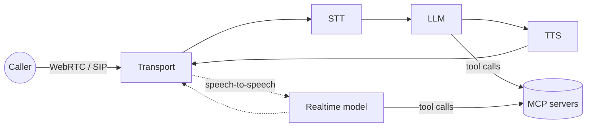

A voice agent is an ordinary tool-using agent with two hard extras: audio has to move in real time (WebRTC, WebSocket or a phone line), and the agent has to know when the person has stopped talking. The five options here split along two questions.

## Do you want a framework, a model API or a platform?

- **Frameworks you run:** [LiveKit Agents](entry:livekit-agents) and [Pipecat](entry:pipecat). Both are open source and vendor-neutral. You write Python, pick providers for each stage and deploy wherever you like. Each has an optional managed cloud (LiveKit Cloud, Pipecat Cloud by Daily).
- **A model API:** the [OpenAI Realtime API](entry:openai-realtime-api) is one speech-to-speech model you call over WebRTC or WebSocket. You still host the app, mint ephemeral keys and run your own tool backend. Both frameworks can also use it as their model.
- **Hosted platforms:** [ElevenAgents](entry:elevenagents) and [Vapi](entry:vapi). You configure an assistant in a dashboard or API, attach a phone number and pay per minute. Testing, analytics and telephony are built in.

## Cascaded pipeline or speech-to-speech?

A **cascaded** agent runs speech-to-text, then an LLM, then text-to-speech. You can pick the best vendor for each stage, read every transcript and use any text LLM, but each hop adds delay. A **speech-to-speech** model (OpenAI Realtime, Eleven Realtime, the realtime plugins in LiveKit and Pipecat) handles audio end to end, which removes the hand-offs between stages, but you are tied to that model's voices and pricing. LiveKit, Pipecat and ElevenAgents support both. Vapi's docs and pricing are built around a transcriber, a model and a voice (cascaded), and OpenAI Realtime voice sessions are speech-to-speech.

## Tools: all five speak MCP

Every option can now call tools on a [Model Context Protocol](entry:model-context-protocol) server, but in different ways:

- **LiveKit** and **Pipecat** connect from your agent process. Pipecat's `MCPClient` turns a server's tools into a `ToolsSchema` for the LLM, with filters for which tools and outputs to expose.
- **OpenAI Realtime** connects for you when you add an `mcp` tool with a `server_url`. Use a `function` tool instead when your own code should run the action or check approvals.
- **Vapi** imports *every* tool the server exposes at the start of each call and opens a new MCP session for each tool call. Its docs warn that large tool lists add latency and timeout risk, so point it at a narrowly scoped server (for example a [Zapier MCP](entry:zapier-mcp) or [Composio](entry:composio) server limited to a few actions).
- **ElevenAgents** attaches MCP servers as agent tools and publishes a security page for third-party servers.

On a live call a slow tool means silence. Keep tool responses small and fast, and put long jobs behind a quick acknowledgement.

## Cost

Per-minute platform fees stack on top of model costs. As of 2026-10-23: Vapi charges $0.05/min hosting plus provider costs, ElevenAgents $0.08 per additional minute plus LLM and telephony at cost, Pipecat Cloud $0.01 per active agent minute (agent-1x) with providers billed separately, and LiveKit Cloud includes 1,000 agent session minutes free, then $0.01/min on paid plans. OpenAI Realtime bills by audio and text tokens, so idle open sessions and long system prompts cost money. OpenAI's cost guide recommends closing idle sessions. Check the pricing pages before you commit, because these numbers change often.

## Caveats

- Latency and accuracy numbers on vendor pages (time to first audio, turn-taking scores) are vendor claims. Measure them on your own calls.
- Voice adds new prompt-injection paths: a caller can say instructions out loud, and tool results get read back. The guide [Test an agent for prompt injection](guide:test-an-agent-for-prompt-injection) applies here too.
- Phone numbers, call recording and data retention bring legal duties (consent, HIPAA, data residency). The plans differ in retention and in zero-data-retention (ZDR) options.
