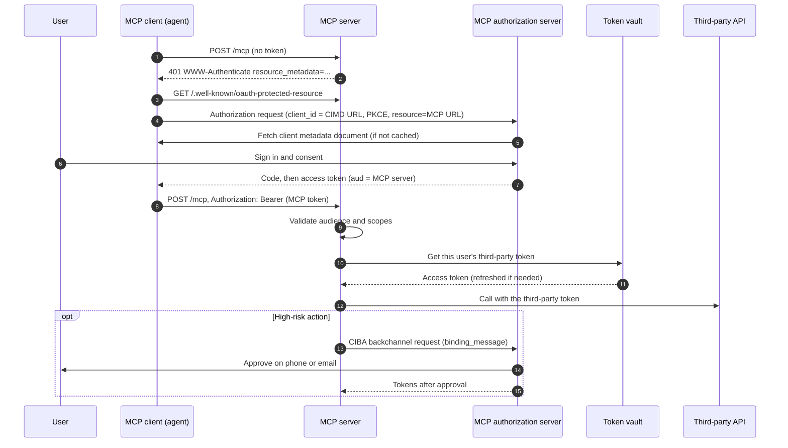

## The picture

There are three separate trust hops. Keep them separate, and most agent-auth mistakes disappear:

1. **Client → MCP server.** The agent's MCP client gets a token from the *MCP server's* authorization server, for that MCP server only ([MCP authorization](entry:mcp-authorization)).
2. **MCP server → third-party API.** The server uses a *different* token, issued by the third party for that user, usually fetched from a vault.
3. **Human approval.** For risky actions, the user approves out of band ([CIBA](entry:openid-ciba)). In enterprises, the IdP can broker app-to-app access instead ([Cross App Access](entry:cross-app-access)).



## 1. Register the client with CIMD

The MCP spec says authorization servers and clients SHOULD support [OAuth Client ID Metadata Documents](entry:oauth-client-id-metadata-document). Dynamic Client Registration is kept for backwards compatibility. The client-side priority order is: pre-registered credentials if you have them, then CIMD, then DCR as a fallback.

With CIMD, the `client_id` *is* an HTTPS URL that serves the client's metadata. This example is from the MCP client-registration page:

```json
{
  "client_id": "https://app.example.com/oauth/client-metadata.json",
  "client_name": "Example MCP Client",
  "client_uri": "https://app.example.com",
  "logo_uri": "https://app.example.com/logo.png",
  "redirect_uris": [
    "http://127.0.0.1:3000/callback",
    "http://localhost:3000/callback"
  ],
  "grant_types": ["authorization_code"],
  "response_types": ["code"],
  "token_endpoint_auth_method": "none"
}
```

Rules from draft-ietf-oauth-client-id-metadata-document-02 and the MCP spec:

- The URL MUST use `https`, contain a path, and have no fragment, userinfo or dot segments. The document's `client_id` MUST exactly match the URL (simple string comparison).
- MCP requires at least `client_id`, `client_name` and `redirect_uris`.
- **No shared secrets.** `client_secret`, `client_secret_basic`/`_post`/`_jwt` MUST NOT be used. A client that can keep a private key becomes confidential by publishing only its public key. The draft's own example:

```json
{
  "token_endpoint_auth_method": "private_key_jwt",
  "jwks_uri": "https://client.example.com/jwks.json"
}
```

- Authorization servers advertise support with `client_id_metadata_document_supported` in their RFC 8414 metadata. They MUST serve only 200 responses, MUST NOT follow redirects when fetching, MUST NOT cache errors, and SHOULD respect HTTP cache headers.
- The draft warns about SSRF: an authorization server MUST NOT fetch metadata documents from internal addresses. Loopback is allowed only in local development.

## 2. Run the OAuth flow the MCP way

These steps follow the MCP 2026-07-28 authorization spec:

1. **Discover.** An unauthenticated request gets `401` with `WWW-Authenticate: Bearer resource_metadata="https://mcp.example.com/.well-known/oauth-protected-resource", scope="files:read"`. MCP servers MUST implement RFC 9728 Protected Resource Metadata, and clients MUST use it to find the authorization server.
2. **Pick scopes.** Use least privilege: request the scopes in the challenge, not everything in `scopes_supported`.
3. **Authorize with PKCE and a resource indicator.** Clients MUST send the RFC 8707 `resource` parameter in **both** the authorization and the token request, set to the MCP server's canonical URI, for example `&resource=https%3A%2F%2Fmcp.example.com`. They must send it even if the authorization server ignores it. Valid canonical forms include `https://mcp.example.com/mcp` and `https://mcp.example.com`. Avoid a trailing slash unless it matters.
4. **Validate the response.** Record the expected `issuer` before redirecting, and validate `iss` per RFC 9207 before redeeming the code. Including `iss` is SHOULD today and is expected to become MUST.
5. **Use the token.** Send it in the `Authorization: Bearer` header on every request, never in the query string.
6. **Server side: check the audience.** MCP servers MUST validate that tokens were issued specifically for them, and must answer invalid or expired tokens with `401`. For missing scope, answer with an `insufficient_scope` challenge, and the client may step up.

Refresh tokens: clients MUST keep them confidential and MUST NOT assume they will get one. MCP servers SHOULD NOT add `offline_access` to the scopes they challenge for.

## 3. Never pass tokens through

From the spec: *"MCP clients MUST NOT send tokens to the MCP server other than ones issued by the MCP server's authorization server"* and *"MCP servers MUST NOT accept or transit any other tokens."* The security best-practices page calls token passthrough an anti-pattern. It lists four risks: it bypasses controls such as rate limits that depend on audience, it breaks the audit trail, it lets a stolen token use your server as an exfiltration proxy, and it breaks trust boundaries.

So the MCP token never goes to Google, and a Google token never comes in as the MCP bearer. If your MCP server proxies a third-party OAuth flow with a single static client ID, the same page requires **per-client consent**: a registry of approved `client_id`s per user, a consent page that names the client, its scopes and its `redirect_uri`, CSRF protection, `frame-ancestors`/`X-Frame-Options: DENY`, and `__Host-` cookies bound to the client. Without it, an existing consent cookie can be replayed (the confused deputy attack).

## 4. Keep third-party tokens in a vault

The MCP server needs the user's own token for each downstream API, stored securely and refreshed automatically. The products do different jobs here:

- **Auth0 Token Vault** is an OAuth token broker. When a user connects a provider (Google, Microsoft, Slack, GitHub, Box, custom OIDC and others) through Connected Accounts, Auth0 stores the access and refresh tokens. Your backend then trades the user's Auth0 token for the provider's token:

```bash
curl --request POST 'https://{yourDomain}/oauth/token' \
  --header 'Content-Type: application/json' \
  --data '{
    "client_id": "<YOUR_CUSTOM_API_CLIENT_ID>",
    "client_secret": "<YOUR_CUSTOM_API_CLIENT_SECRET>",
    "subject_token": "<YOUR_AUTH0_ACCESS_TOKEN>",
    "grant_type": "urn:auth0:params:oauth:grant-type:token-exchange:federated-connection-access-token",
    "subject_token_type": "urn:ietf:params:oauth:token-type:access_token",
    "requested_token_type": "http://auth0.com/oauth/token-type/federated-connection-access-token",
    "connection": "google-oauth2"
  }'
```

  Refresh-token and privileged-worker (JWT bearer) exchanges are also documented.
- **Descope Connections** (also called Outbound Apps) is a vault for OAuth tokens *and* API keys, per user or per tenant, with Descope handling storage and refresh. Descope recommends putting an MCP server or gateway between the agent and the vault, so long-lived third-party secrets never reach the agent.
- **[WorkOS Vault](entry:workos-vault)** is encrypted key-value storage (EKM): each object gets its own key, isolated by a context you supply, with BYOK support. It does **not** run the third-party OAuth dance or refresh tokens for you. You store and update what your own OAuth code obtains:

```python
from workos import WorkOSClient

client = WorkOSClient(api_key="sk_example_123456789", client_id="client_123456789")

client.vault.create_kv(
    key_context={"organization_id": "org_01K8ZYT4AWJ6XP0E0S8CTBHE3P"},
    name="my-secret",
    value="s3cr3t-v4lu3",
)
# later: client.vault.update_kv(id_=..., value=...) after you refresh
```

In short: Auth0 or Descope if you want the provider connection and refresh handled for you; WorkOS Vault if you run the OAuth clients yourself and need strong, tenant-scoped encryption. [Arcade](entry:arcade) is a fourth model: a tool runtime that holds the user tokens and runs the tool call itself.

## 5. Ask the human out of band with CIBA

OpenID CIBA Core 1.0 lets a client start authentication without a browser redirect. The user approves on another device. This fits an agent that needs sign-off before a payment or deletion. The client posts to the OP's `backchannel_authentication_endpoint`, identifying the user with a hint, optionally with a `binding_message` shown on both devices:

```http
POST /bc-authorize HTTP/1.1
Host: server.example.com
Content-Type: application/x-www-form-urlencoded

scope=openid%20email%20example-scope&
client_notification_token=8d67dc78-7faa-4d41-aabd-67707b374255&
binding_message=W4SCT&
login_hint_token=eyJraWQiOiJsdGFjZXNidyIsImFsZyI6IkVTMjU2In0...&
client_assertion_type=urn%3Aietf%3Aparams%3Aoauth%3Aclient-assertion-type%3Ajwt-bearer&
client_assertion=eyJraWQiOiJsdGFjZXNidyIsImFsZyI6IkVTMjU2In0...
```

The OP acknowledges with an id to track:

```json
{
  "auth_req_id": "1c266114-a1be-4252-8ad1-04986c5b9ac1",
  "expires_in": 120,
  "interval": 2
}
```

The client gets the result in one of three modes, fixed at registration. In **poll** mode it calls the token endpoint with `grant_type=urn:openid:params:grant-type:ciba` and the `auth_req_id`, waiting `interval` seconds between calls. In **ping** mode the OP notifies a callback and the client then fetches the tokens. In **push** mode the OP sends the tokens to the callback. Put the action and amount in `binding_message` (or in RAR details, where your provider supports them), so the user knows exactly what they are approving. Auth0 (with the AI Agents add-on) and Descope (confidential clients, off by default) implement CIBA; see the [comparison](comparison:agent-identity-and-mcp-auth).

## 6. Enterprise delegation with Cross App Access (ID-JAG)

In a company where every app uses SSO through one IdP, the Identity Assertion JWT Authorization Grant (draft-ietf-oauth-identity-assertion-authz-grant-04) defines **Cross-App Access (XAA)**. The IdP, not the user clicking through a consent screen per app, brokers one app's access to another app's API. This lets admins set policy centrally.

Step one: the requesting app exchanges the user's ID token at the IdP for an ID-JAG (RFC 8693 token exchange):

```http
POST /oauth2/token HTTP/1.1
Host: acme.idp.example
Content-Type: application/x-www-form-urlencoded

grant_type=urn:ietf:params:oauth:grant-type:token-exchange
&requested_token_type=urn:ietf:params:oauth:token-type:id-jag
&audience=https://acme.chat.example/
&resource=https://api.chat.example/
&scope=chat.read+chat.history
&subject_token=eyJraWQiOiJzMTZ0cVNtODhwREo4VGZCXzdrSEtQ...
&subject_token_type=urn:ietf:params:oauth:token-type:id_token
&client_assertion_type=urn:ietf:params:oauth:client-assertion-type:jwt-bearer
&client_assertion=eyJhbGciOiJSUzI1NiIsImtpZCI6IjIyIn0...
```

The result is a JWT with `typ: oauth-id-jag+jwt`, whose `aud` is the target app's authorization server, plus `client_id`, `resource` and `scope`. Step two: the app presents it to that authorization server with `grant_type=urn:ietf:params:oauth:grant-type:jwt-bearer` (RFC 7523) and gets a normal access token for the target API. Auth0 and Stytch both document Cross App Access support. Check that your IdP and the target app both implement the current draft.

## Security checklist

- [ ] The MCP server publishes RFC 9728 metadata and returns `401` with `resource_metadata` on missing tokens.
- [ ] The authorization server supports CIMD (or pre-registration). DCR is enabled only if you need it for older clients.
- [ ] CIMD fetching blocks private and loopback addresses, follows no redirects, and caches only valid documents.
- [ ] No shared secrets in metadata documents. Confidential clients use `private_key_jwt` with `jwks_uri`.
- [ ] PKCE on every authorization code flow. `iss` is validated per RFC 9207.
- [ ] The `resource` parameter is in both the authorization and the token request.
- [ ] The server validates `aud` (and issuer, expiry, scopes) on every request, and rejects tokens not issued for it.
- [ ] No token passthrough in either direction. Downstream calls use vaulted, per-user third-party tokens.
- [ ] Per-client consent if the server proxies a third-party OAuth flow with a static client ID.
- [ ] Least-privilege scopes, with step-up on `insufficient_scope` instead of broad upfront grants.
- [ ] Refresh tokens are kept confidential at rest and in transit. `offline_access` is not challenged by the MCP server.
- [ ] Third-party tokens live in a vault, scoped per user or tenant, and never reach the model's context or logs.
- [ ] High-risk actions go through CIBA (or another out-of-band approval), with a specific `binding_message`.
- [ ] Every token use is logged with user, client and resource, so actions can be traced back.

Test the discovery and sign-in steps with [MCP Inspector](entry:mcp-inspector). For client configuration, see [Connect an agent to a remote MCP server](guide:connect-an-agent-to-a-remote-mcp-server).
