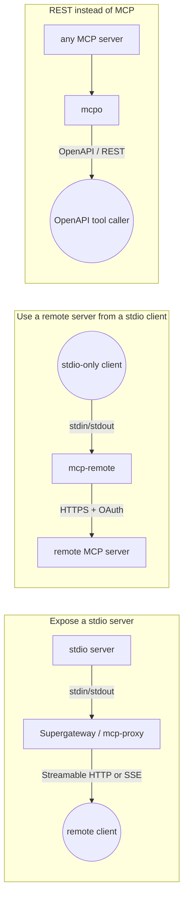

MCP has two standard transports. **stdio**: the client starts the server as a child process and talks over stdin/stdout. **Streamable HTTP** (and the older SSE transport): the server is a web endpoint that any client on the network can reach. Many useful servers still ship stdio only, and a few clients still only launch stdio servers. A *bridge* translates between the two, so you don't have to rewrite either side.

## Which direction do you need?

| You have | You want | Use |
|---|---|---|
| A stdio server on your machine | Remote agents, a cloud IDE or a hosted client to call it over HTTP | [Supergateway](entry:supergateway) `--stdio` or [mcp-proxy](entry:mcp-proxy) server mode |
| A remote MCP URL (possibly OAuth-protected) | A client that only launches stdio servers | [mcp-remote](entry:mcp-remote), or Supergateway / mcp-proxy client mode |
| Any MCP server | Plain REST with an OpenAPI schema (Open WebUI, OpenAPI tool callers, curl) | [mcpo](entry:mcpo) |



## The four bridges at a glance

| | [mcp-remote](entry:mcp-remote) | [Supergateway](entry:supergateway) | [mcp-proxy](entry:mcp-proxy) | [mcpo](entry:mcpo) |
|---|---|---|---|---|
| Version we ran (2026-10-25) | 0.15.2 (npm) | 4.2.1 (npm) | 0.13.0 (PyPI, Python ≥3.10) | 0.0.20 (PyPI, Python ≥3.11) |
| stdio → network | no | SSE, WebSocket or Streamable HTTP | SSE and Streamable HTTP on one port | REST + OpenAPI (not MCP) |
| network → stdio | yes (HTTP first, SSE fallback by default) | yes (`--sse` / `--streamableHttp`) | yes (SSE, or `--transport=streamablehttp`) | n/a |
| OAuth to the upstream server | full browser flow, tokens in `~/.mcp-auth` | static bearer token (`--oauth2Bearer`) or headers | OAuth2 client credentials, basic/digest, headers | OAuth 2.1 with dynamic client registration (Streamable HTTP upstreams) |
| Auth for *your* endpoint | n/a (local process) | `--apiKey` / `--apiKeyFile` | none documented | `--api-key` |
| Default listen address | n/a | every interface | 127.0.0.1, random port | 0.0.0.0:8000, CORS `*` |
| Several servers | one per process | `--config` with an `mcpServers` file, or several combined on one URL | `--named-server` / `--named-server-config` at `/servers/<name>/` | `--config` (Claude Desktop format), one route per server, `--hot-reload` |
| License | MIT | MIT | MIT | MIT |

Versions are the latest on npm and PyPI on 2026-10-25. Defaults come from each README, except mcpo's listen address and CORS default, which come from its CLI source and matched what mcpo logged when we started it.

## 1. Expose a stdio server over Streamable HTTP (Supergateway)

Supergateway has the most complete server mode. The command below wraps the reference filesystem server (from [the MCP reference servers](entry:mcp-reference-servers)), binds to localhost, requires a key and exposes only two read tools:

```bash
export MCP_API_KEY="$(openssl rand -hex 24)"
npx -y supergateway@4.2.1 \
  --stdio "npx -y @modelcontextprotocol/server-filesystem /srv/shared" \
  --outputTransport streamableHttp \
  --host 127.0.0.1 --port 8000 \
  --apiKey "$MCP_API_KEY" \
  --tools list_directory --tools read_text_file
```

The endpoint is `http://127.0.0.1:8000/mcp`. When we ran this on 2026-10-25:

- An `initialize` request without a key got **HTTP 401**.
- With `Authorization: Bearer <key>` (or `X-API-Key: <key>`) it answered `initialize`, and `tools/list` returned only `read_text_file` and `list_directory`.
- A `tools/call` for `write_file` came back as JSON-RPC error `-32602 "Unknown tool: write_file"` and never reached the server, as the README describes.

Useful flags from the README:

- `--stateful` (with `--sessionTimeout`) keeps legacy MCP sessions. The default stdio→Streamable HTTP mode is stateless.
- `--healthEndpoint /healthz --healthCheck server` actually starts and pings the wrapped server instead of only reporting that the gateway is up.
- `--toolPrefix github_` renames tools so two servers' tools don't collide.
- `--config servers.json` reads the same `mcpServers` file that desktop clients use and serves each server at `/<name>`. An entry with its own `mcpServers` combines several servers behind one URL.
- Standalone executables (Homebrew `supercorp-ai/tap/supergateway`, GitHub releases) and Docker images (`supercorp/supergateway`, plus `:uvx` and `:deno` variants) exist if you don't want Node on the host.

## 2. Use a remote server from a stdio-only client (mcp-remote)

Most current clients ([Claude Code](entry:claude-code), [Cursor](entry:cursor), [Codex CLI](entry:codex-cli)) connect to remote servers natively. Check that first: the guide [Connect an agent to a remote MCP server](guide:connect-an-agent-to-a-remote-mcp-server) covers it, and its README says mcp-remote is meant to be removed once your client supports remote, authorized servers. For a client that only launches commands, add mcp-remote as the command:

```json
{
  "mcpServers": {
    "remote-example": {
      "command": "npx",
      "args": ["-y", "mcp-remote", "https://remote.mcp.server/mcp"]
    }
  }
}
```

What the README documents:

- **OAuth.** mcp-remote runs the browser sign-in itself and caches credentials in `~/.mcp-auth` (or `MCP_REMOTE_CONFIG_DIR`). `--resource` sends an [RFC 8707](entry:rfc-8707) resource indicator and keeps separate sessions per tenant. `--authorize-param` adds provider-specific parameters (for example `access_type=offline` for Google). `--disable-resource-parameter` is for servers like Microsoft Entra ID that reject the resource parameter.
- **Static tokens.** Use `--header "Authorization:${AUTH_HEADER}"` with the value in `env`, without spaces around the colon. The README says Cursor, Codex CLI and Claude Desktop on Windows mangle spaces inside `args`. Better still, use `--header-file`, so the token doesn't show up in the process list.
- **Transport.** `--transport` is `http-first` (default), `sse-first`, `http-only` or `sse-only`.
- **Plain HTTP** is refused unless you pass `--allow-http`, which is meant only for trusted private networks.
- **Debugging.** `npx -p mcp-remote@latest mcp-remote-client <url>` runs the whole auth flow and lists tools outside your client. `--debug` writes logs to `~/.mcp-auth/`.

**Round trip we ran.** We pointed mcp-remote 0.15.2 at the Supergateway endpoint from step 1 (in `--stateful` mode, with `--allow-http` because it was on localhost and `--header "Authorization:Bearer <key>"`). Then we piped `initialize` and `tools/list` into its stdin. The filesystem server's answers came back on stdout: stdio → HTTP → stdio, with no code written.

## 3. The Python alternative (mcp-proxy)

mcp-proxy does both directions in one Python tool. To expose a server:

```bash
uv tool install mcp-proxy        # or: pipx install mcp-proxy
mcp-proxy --port 8080 -- npx -y @modelcontextprotocol/server-filesystem /srv/shared
```

On 2026-10-25, version 0.13.0 listened on 127.0.0.1 and served both transports from the same port: Streamable HTTP at `/mcp` (it answered `initialize` with an `mcp-session-id`) and SSE at `/sse`. It also had a `/status` JSON endpoint. Pass `--stateless` for stateless Streamable HTTP. To use a remote server from a stdio client, give it the URL instead of a command: `mcp-proxy --transport=streamablehttp https://host/mcp`, with `API_ACCESS_TOKEN` or `--headers`, OAuth2 client credentials (`--client-id`, `--client-secret`, `--token-url`) or basic/digest auth.

**Caveat:** the README documents no authentication for the endpoint mcp-proxy serves. Keep it on 127.0.0.1 (the default) or put an authenticating reverse proxy in front of it. Don't bind it to `0.0.0.0` on an open network.

## 4. MCP as REST (mcpo)

mcpo isn't an MCP bridge. It turns each MCP tool into a REST endpoint with a generated OpenAPI schema and docs at `/docs`, for tools that speak OpenAPI rather than MCP (it comes from the Open WebUI project). Upstreams can be stdio, SSE or Streamable HTTP, and `--config` serves several servers at `/<name>`.

**What we hit on 2026-10-25.** The README command `uvx mcpo ...` failed at startup in two different ways, because mcpo 0.0.20 only sets lower bounds on its dependencies (`mcp>=1.17.0`, `fastapi>=0.115.12`):

1. uv resolved `mcp` 2.3.0, and mcpo crashed with `ImportError: cannot import name 'streamablehttp_client'`. Open issue [#303](https://github.com/open-webui/mcpo/issues/303) tracks this.
2. After pinning `mcp<2`, it crashed again with `TypeError: FastAPI.__init__() got an unexpected keyword argument 'ssl_certfile'` (FastAPI 0.162.0 had been resolved).

This pin worked:

```bash
uvx --with "mcp<2" --with "fastapi<0.130" mcpo@0.0.20 \
  --host 127.0.0.1 --port 8000 --api-key "$MCP_API_KEY" \
  -- npx -y @modelcontextprotocol/server-filesystem /srv/shared
```

We picked `<0.130` as a known-good bound and didn't track down the exact FastAPI release that breaks it. With the pin, a request without the key got 401. `POST /read_text_file` with `Authorization: Bearer <key>` returned the file. `/openapi.json` listed one path per filesystem tool, *including* `write_file`, `edit_file` and `move_file`, so use `disabledTools` in a config file to hide the ones you don't want exposed. Note that mcpo binds to `0.0.0.0` with CORS `*` by default, so always pass `--host 127.0.0.1` and `--api-key` unless you really mean to serve the whole network. The README says "Python 3.8+", but PyPI lists `Requires-Python >=3.11`.

## Lock it down before you expose anything

A bridge turns a process that only you could start into a network service. The [MCP transport spec](https://modelcontextprotocol.io/specification/2025-11-25/basic/transports) says servers **must** validate the `Origin` header (to stop DNS-rebinding attacks from web pages) and **should** bind only to localhost when running locally. Bridges sit outside your server, so these checks are on you:

1. **Bind to 127.0.0.1** (`--host`) and publish through a reverse proxy or tunnel that terminates HTTPS. Supergateway's README says to use HTTPS so keys aren't sent in clear text.
2. **Require a key** (Supergateway `--apiKey`, mcpo `--api-key`). For per-user access, audit logs and policy, put a real gateway in front instead. The [MCP gateways comparison](comparison:mcp-gateways) covers [Docker MCP Gateway](entry:docker-mcp-gateway) and [ToolHive](entry:toolhive), and [LiteLLM's MCP gateway](entry:litellm-mcp-gateway) also accepts stdio servers. For OAuth on your own server, see [Add OAuth to your MCP server](guide:add-oauth-to-your-mcp-server).
3. **Expose the fewest tools you can** (Supergateway `--tools`, mcpo `disabledTools`). A filesystem or shell server reachable over HTTP is remote code execution waiting to happen. Scope its directory, and consider running it in a container or sandbox (see [Run untrusted code in a sandbox](guide:run-untrusted-code-in-a-sandbox)).
4. **Leave CORS off** unless a browser client needs it, and then list origins explicitly. mcpo's default of `*` is the one to override.
5. **Pin versions** (`supergateway@4.2.1`, `mcp-remote@0.15.2`, `mcpo@0.0.20`). Unpinned `npx`/`uvx` runs fetch whatever is newest, and the mcpo breakage above shows that a dependency's major release can break a bridge overnight.
6. **Test the endpoint** before giving it to an agent: [MCP Inspector](entry:mcp-inspector) connects to Streamable HTTP and SSE URLs. The guide [Test your MCP server](guide:test-your-mcp-server) has a checklist.

## Choosing quickly

- **Just need Claude Desktop-style stdio config to reach a hosted OAuth server:** mcp-remote.
- **Need to share a local stdio server with remote agents, with a key and a tool allowlist:** Supergateway.
- **Python-only environment, or you want SSE and Streamable HTTP from one process:** mcp-proxy, kept on localhost behind an authenticating proxy.
- **Your consumer speaks OpenAPI, not MCP:** mcpo, with the dependency pin above until issue #303 is resolved.
- **Many servers, many users, audit requirements:** skip the bridges and use a gateway ([MCP gateways compared](comparison:mcp-gateways)).

To find stdio servers worth bridging, or a hosted server that makes the bridge unnecessary, search Index Agentica with the [pick-an-mcp-server](skill:pick-an-mcp-server) skill.
