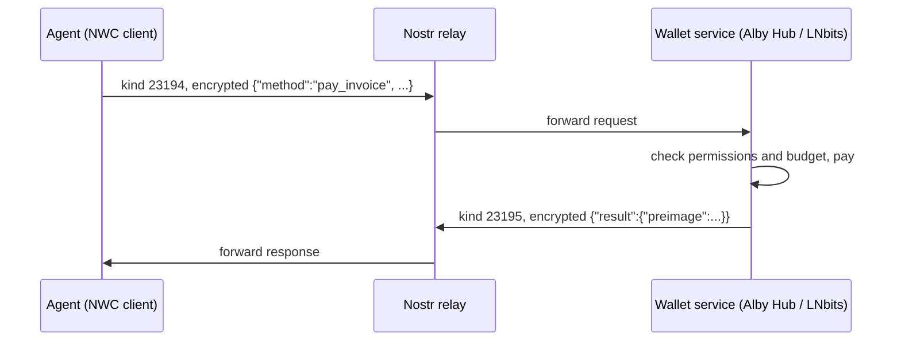

[Nostr Wallet Connect](entry:nostr-wallet-connect) (NWC) lets an app, or an agent, control a Lightning wallet it does not run. The wallet hands out a connection string with its own key and its own permissions, and the agent sends encrypted payment requests over Nostr relays. The agent never holds node keys or channel state, and you can revoke one connection without touching the others. That makes it a good fit for giving an agent a small, capped allowance.

No real payments were made while writing this guide. The code below was syntax-checked and run against the example connection string in the NIP-47 spec, which has no wallet behind it, so only the error path was exercised.

## What NWC is (from NIP-47)

NIP-47 defines three roles: the **client** (your agent), the **wallet service** (the software in front of the Lightning node) and one or more **relays** that carry messages between them. The wallet service publishes an info event of kind `13194` listing the commands it supports. The client sends requests as kind `23194` events and gets responses as kind `23195`. Content is encrypted, NIP-44 is preferred and NIP-04 is deprecated, and the two sides agree on the scheme through an `encryption` tag.



The connection string is a URI with the wallet's public key, the relay and a secret the client signs with:

```
nostr+walletconnect://b889ff5b1513b641e2a139f661a661364979c5beee91842f8f0ef42ab558e9d4?relay=wss%3A%2F%2Frelay.damus.io&secret=71a8c14c1407c113601079c4302dab36460f0ccd0ad506f1f2dc73b5100e4f3c
```

(That is the spec's example. A real one is a spending credential: treat it like an API key.)

The commands an agent mostly needs:

| Command | What it does | Key fields |
|---|---|---|
| `pay_invoice` | Pay a BOLT11 invoice | params `invoice`, optional `amount` (msats); result `preimage`, `fees_paid` |
| `get_balance` | Read the balance | result `balance` in msats |
| `make_invoice` | Create an invoice to receive | `amount`, `description` |
| `lookup_invoice` | Check an invoice's status | `payment_hash` or `invoice` |
| `get_info` | Which methods this connection may call | `methods` |

Errors come back with a code such as `INSUFFICIENT_BALANCE`, `QUOTA_EXCEEDED`, `RESTRICTED`, `UNAUTHORIZED`, `RATE_LIMITED`, `NOT_IMPLEMENTED` or, for `pay_invoice`, `PAYMENT_FAILED`. The spec leaves limits to the wallet: a connection key may carry arbitrary constraints, such as a budget. Optional extras, such as the budget query used below, are kept in the separate NWC extensions repo rather than in NIP-47 itself.

## Step 1: create a capped connection

Make a separate connection for each agent, with only the methods it needs and a budget that resets.

### Alby Hub

[Alby Hub](entry:alby-hub) is a self-custodial wallet service (Apache-2.0). In the UI, add an app connection and set its permissions, budget and expiry. The same options are available as query parameters on the `/apps/new` page, which is handy when a setup script links you to it:

| Parameter | Meaning |
|---|---|
| `name` | Label for the connection |
| `max_amount` | Budget in msats per renewal period |
| `budget_renewal` | `never`, `daily`, `weekly`, `monthly` or `yearly` |
| `request_methods` | Space-separated allowed methods, e.g. `pay_invoice get_balance` (default `pay_invoice`) |
| `expires_at` | When the connection stops working |
| `isolated=true` | The connection gets its own balance and transaction list, but no custom methods, budget or expiry |

For an agent, allow `pay_invoice get_balance get_info`, set a daily budget, and give it an expiry. If you want the agent's spending fully separated from the rest of the wallet, use an isolated connection and fund it with only what it may spend; note that this replaces the budget rather than adding to it.

### LNbits

[LNbits](entry:lnbits) (MIT) supports NWC through the **NWC Service Provider** extension (`nwcprovider`, MIT):

1. Install the extension from the LNbits admin UI.
2. As admin, open `/nwcprovider/admin` and set the relay, for example `wss://relay.nostrconnect.com`.
3. In a wallet, open the extension, press **+**, and fill in a description, expiry, permissions and spending limits.
4. Press **Connect** to get the pairing URL or QR code.

Use a dedicated LNbits wallet for the agent, so the wallet balance is a second cap on top of the connection limits.

## Step 2: connect the agent

### Option A: the Alby JS SDK

```bash
npm install @getalby/sdk @getalby/lightning-tools
```

`NWCClient` from `@getalby/sdk/nwc` wraps the NIP-47 commands (`getInfo`, `getBalance`, `payInvoice`, `makeInvoice`, `lookupInvoice`, `listTransactions` and more) plus `getBudget`. This script checks balance and budget, then pays an invoice only if it is under a cap you set in code:

```js
// agent-wallet.mjs: check balance and budget, then pay an invoice only under a hard per-payment cap.
import { NWCClient } from "@getalby/sdk/nwc";
import { Invoice } from "@getalby/lightning-tools";

const MAX_SATS_PER_PAYMENT = 1000; // your own cap, on top of the wallet-side budget

const nwc = new NWCClient({ nostrWalletConnectUrl: process.env.NWC_URL });

try {
  const info = await nwc.getInfo();               // which methods this connection may call
  console.log("methods:", info.methods);

  const { balance } = await nwc.getBalance();     // millisats (NIP-47)
  console.log("balance (sats):", Math.floor(balance / 1000));

  const budget = await nwc.getBudget();           // extension; {} if no budget is set
  if ("total_budget" in budget) {
    console.log(`budget: ${budget.used_budget}/${budget.total_budget} msat, renews ${budget.renewal_period}`);
  }

  const pr = process.argv[2];                     // a bolt11 invoice, if you want to pay one
  if (pr) {
    const invoice = new Invoice({ pr });
    if (invoice.satoshi > MAX_SATS_PER_PAYMENT) throw new Error(`refusing: ${invoice.satoshi} sats > cap`);
    if (invoice.expiryDate && invoice.expiryDate < new Date()) throw new Error("refusing: invoice expired");
    const { preimage, fees_paid } = await nwc.payInvoice({ invoice: pr });
    console.log("paid; preimage:", preimage, "fees (msat):", fees_paid);
  }
} catch (e) {
  console.error("NWC error:", e.code ?? "", e.message); // e.g. QUOTA_EXCEEDED, INSUFFICIENT_BALANCE, RESTRICTED
  process.exitCode = 1;
} finally {
  nwc.close();
}
```

Run it with `NWC_URL="nostr+walletconnect://..." node agent-wallet.mjs` to read the balance, or add an invoice as the first argument to pay it. Tested with `@getalby/sdk` 8.0.3 and `@getalby/lightning-tools` 9.0.1. `getBudget` returns `used_budget`, `total_budget`, `renewal_period` and optionally `renews_at`, or an empty object when the connection has no budget. Amounts in NWC are in millisats; `Invoice.satoshi` is in sats.

The SDK also has a simpler `LN` class in `@getalby/sdk/lnclient` (`await new LN(credentials).pay("lnbc...")`) if you do not need the raw commands.

### Option B: the Alby MCP server

For an agent that speaks MCP, the Alby MCP server exposes the wallet as tools. Its `nwc` tools are `get_balance`, `get_info`, `get_wallet_service_info`, `list_transactions`, `lookup_invoice`, `make_invoice` and `pay_invoice`; its `lightning` tools are `fetch_l402`, `fiat_to_sats`, `parse_invoice` and `request_invoice`.

Run it locally so the connection secret stays on your machine:

```json
{
  "mcpServers": {
    "alby": {
      "command": "npx",
      "args": ["-y", "@getalby/mcp"],
      "env": { "NWC_CONNECTION_STRING": "nostr+walletconnect://..." }
    }
  }
}
```

With `MODE=HTTP` it serves `http://localhost:3000/mcp` instead, bound to 127.0.0.1. Alby also hosts it at `https://mcp.getalby.com/mcp` (and `/sse`), with the connection string sent as a Bearer token, for example in Claude Code:

```bash
claude mcp add --transport http alby https://mcp.getalby.com/mcp \
  --header "Authorization: Bearer nostr+walletconnect://..."
```

The hosted option means Alby receives your connection secret, so give it only a tightly capped connection. For more on wiring servers, see [Add MCP servers to Claude Code](guide:add-mcp-servers-to-claude-code) and [Connect an agent to a remote MCP server](guide:connect-an-agent-to-a-remote-mcp-server).

For Lightning agents more broadly, Lightning Labs' [Lightning Agent Tools](entry:lightning-agent-tools) is an alternative route built around its own node software.

## Step 3: budgets and safety

- **One connection per agent.** You can revoke it alone, and its budget and history are its own.
- **Least privilege.** Allow `pay_invoice` and `get_balance` (plus `get_info`); leave out `make_invoice`, `list_transactions` and anything else the agent does not use.
- **Two caps.** A renewing budget in the wallet (`max_amount` with `budget_renewal` in Alby Hub, limits in LNbits) and a per-payment cap in your own code, checked by decoding the invoice before paying. Neither alone is enough: the budget bounds total loss, the code cap stops one bad invoice from eating the whole budget.
- **Expiry.** Set `expires_at` or an LNbits expiry so a forgotten connection stops working.
- **Small, dedicated funds.** Use an isolated Alby Hub connection or a dedicated LNbits wallet, funded with only what the agent may lose.
- **Keep the secret out of the model.** Pass the connection string through an environment variable or MCP config, never in a prompt or tool output, and never log it.
- **Treat invoices as untrusted input.** An invoice can arrive from a web page or another agent. Check the amount and description against what the task expects, and require human confirmation above a threshold.
- **Handle the error codes.** `QUOTA_EXCEEDED` means the budget is spent; stop and report rather than retrying. `PAYMENT_FAILED` may be retried; `RESTRICTED` and `UNAUTHORIZED` mean the connection does not allow it.
- **Keep the preimage.** It is the proof of payment and what L402 servers ask for.

## How NWC relates to L402 and x402

NWC is a way to **control a wallet**. [L402](entry:l402) and [x402](entry:x402) are ways for a **server to ask for payment** over HTTP 402. They work at different layers, so an agent can use NWC as the wallet behind either.

- **L402:** the server answers with `402` and a `WWW-Authenticate` header carrying a token and a Lightning invoice. The client pays the invoice and presents the token with the preimage. NWC's `pay_invoice` returns exactly that preimage.
- **x402:** most x402 payments are signed stablecoin transfers on a blockchain, which NWC does not do; see [Pay for an API as an agent with x402](guide:pay-for-an-api-with-x402). An NWC wallet only helps when an x402 server offers a Lightning payment option.

`@getalby/lightning-tools` joins these up. `fetch402` detects L402, X402 or MPP from the response headers and pays with any wallet that implements `payInvoice({ invoice })`, which `NWCClient` does:

```js
import { fetch402 } from "@getalby/lightning-tools/402";
import { NWCClient } from "@getalby/sdk/nwc";

const nwc = new NWCClient({ nostrWalletConnectUrl: process.env.NWC_URL });
const res = await fetch402("https://example.com/protected-resource", {}, { wallet: nwc });
console.log(await res.json());
nwc.close();
```

`fetch402` pays whatever the server asks, so wrap the wallet with your own amount check, as in Step 2, before handing it over. The Alby MCP server's `fetch_l402` tool does the same for MCP agents; it does not follow redirects. To compare these rails with cards and stablecoins, see [Agent payment rails](comparison:agent-payment-rails).

## Troubleshooting

- **`no info event (kind 13194) returned from relay`**: the relay in the connection string has no wallet service on it, or the wallet is offline. Check the relay URL and that Alby Hub or LNbits is running.
- **Timeouts**: the relay or wallet is slow or unreachable; the SDK raises timeout errors rather than hanging.
- **`RESTRICTED`**: the method is not enabled for this connection. Add it to the permissions.
- **`QUOTA_EXCEEDED`**: the budget for the period is used. Wait for renewal or raise `max_amount`.
