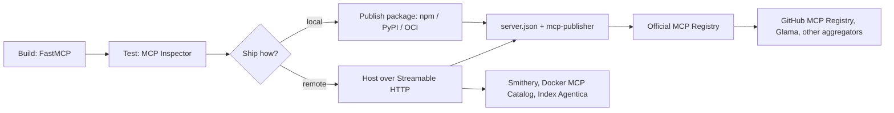

A working MCP server is only half the job. Agents and their humans find servers through registries and directories, and most of those now read from one place: the [official MCP Registry](entry:official-mcp-registry). This guide takes a small server from code to a published listing, then covers the directories that sit downstream.

What was actually run for this guide, on 2026-10-17: the FastMCP server below (FastMCP 4.1.0), the MCP Inspector CLI calls against it over HTTP and stdio (Inspector 2.11.0), and `mcp-publisher validate` on the example `server.json`. Nothing was published to any registry.



## 1. Build a small server with FastMCP

[FastMCP](entry:fastmcp) is a Python framework for MCP servers. Install it with `uv add fastmcp` or `pip install fastmcp` (it needs Python 3.10 or later), and check with `fastmcp version`.

A tool is a decorated function. Type hints become the input schema and the docstring becomes the description that agents read, so write it for them:

```python
# server.py
from fastmcp import FastMCP

mcp = FastMCP("Unit Converter")

@mcp.tool
def km_to_miles(km: float) -> float:
    """Convert kilometres to miles."""
    return round(km * 0.621371, 4)

if __name__ == "__main__":
    mcp.run(transport="http", host="127.0.0.1", port=8765)
```

Run it with `python server.py`. With the HTTP transport the endpoint is at `/mcp`, here `http://127.0.0.1:8765/mcp`. Calling `mcp.run()` with no arguments uses stdio instead, which is what local, package-based installs use. The CLI can choose at launch: `fastmcp run server.py:mcp --transport http --port 8000`.

## 2. Test it with the MCP Inspector

The [MCP Inspector](entry:mcp-inspector) has a web UI (`npx @modelcontextprotocol/inspector`), a TUI (`--tui`) and a scriptable CLI (`--cli`). The CLI is the one to use from an agent or in CI:

```bash
# List tools (a URL ending in /mcp means Streamable HTTP)
npx @modelcontextprotocol/inspector --cli http://127.0.0.1:8765/mcp --method tools/list

# Call one
npx @modelcontextprotocol/inspector --cli http://127.0.0.1:8765/mcp \
  --method tools/call --tool-name km_to_miles --tool-arg km=42
```

Against the server above, the call returned `"structuredContent": {"result": 26.0976}` and `"isError": false`. `tools/list` showed the `km` input schema and an output schema that FastMCP generated from the return type. Other useful methods are `initialize` (a connect-only probe), `resources/list` and `prompts/list`. For stdio, pass a command instead of a URL. For example, `--cli fastmcp run server.py:mcp` starts the same server over stdio, because the FastMCP CLI ignores the `__main__` block. Add `--header "X-API-Key: ..."` for an authenticated remote.

The Inspector stores OAuth tokens and stdio `env:` secrets in the OS keychain. On a machine without one, such as a headless Linux box or a container, they go to `~/.mcp-inspector/secrets.json`, unencrypted unless you supply a key.

## 3. Decide how it ships: remote or package

The registry lists two kinds of install, and one server can offer both.

**Remote (hosted) server.** Clients connect to a URL, and nothing is installed. Remote servers should use Streamable HTTP; SSE is deprecated and worth publishing only for existing clients. For production, FastMCP can give you an ASGI app to run under Uvicorn or similar:

```python
app = mcp.http_app()          # serve with: uvicorn server:app --host 0.0.0.0 --port 8000
```

FastMCP's deployment guide calls authentication "highly recommended" for remote servers and notes that some clients refuse to connect without it. Bearer tokens, JWT and OAuth are covered in its auth docs, and the protocol side is in [MCP authorization](entry:mcp-authorization). The guide also documents an opt-in Host and Origin check against DNS rebinding (`host_origin_protection=True` with `allowed_hosts`). It is off by default, so turn it on or enforce the same checks in your reverse proxy. For managed hosting, the FastMCP docs point to Prefect Horizon, which they describe as free for personal projects.

**Package (local) server.** Users run it with `npx`, `uvx`, `dnx`, Docker and similar tools. The registry hosts only metadata, so publish the package first. Each package type proves that it belongs to your registry name differently:

| Package type | `registryType` | Ownership marker |
|---|---|---|
| npm | `npm` | `"mcpName": "<server name>"` in `package.json` |
| PyPI | `pypi` | `mcp-name: <server name>` in the README, which can be hidden in an HTML comment |
| NuGet | `nuget` | `mcp-name: <server name>` in the README |
| Cargo | `cargo` | `mcp-name: <server name>` as visible text, because crates.io strips HTML comments |
| Docker/OCI | `oci` | `io.modelcontextprotocol.server.name` annotation on the image |

## 4. Publish to the official MCP Registry

The registry is in preview, and its docs warn that breaking changes or data resets may happen before general availability.

**Install the publisher** (a prebuilt binary, or `brew install mcp-publisher`):

```bash
curl -L "https://github.com/modelcontextprotocol/registry/releases/latest/download/mcp-publisher_$(uname -s | tr '[:upper:]' '[:lower:]')_$(uname -m | sed 's/x86_64/amd64/;s/aarch64/arm64/').tar.gz" | tar xz mcp-publisher
```

**Write `server.json`.** `mcp-publisher init` makes a template from your project. For a remote-only server, replace the generated `packages` array with `remotes`:

```json
{
  "$schema": "https://static.modelcontextprotocol.io/schemas/2025-12-11/server.schema.json",
  "name": "io.github.your-username/unit-converter",
  "title": "Unit Converter",
  "description": "Converts kilometres to miles. A minimal example remote MCP server.",
  "repository": { "url": "https://github.com/your-username/unit-converter-mcp", "source": "github" },
  "version": "1.0.0",
  "remotes": [
    { "type": "streamable-http", "url": "https://mcp.example.com/mcp" }
  ]
}
```

Rules worth knowing before you publish:

- `description` is limited to 100 characters.
- A remote URL must be publicly reachable, and each URL can belong to only one server name.
- Remotes can declare required `headers` (such as an API key marked `isSecret`) and URL template `variables` (such as `{tenant_id}`), and they can sit alongside `packages`.
- Each publish needs a new, unique `version`. Published metadata is immutable, so you fix mistakes by publishing a new version. Semantic versions are recommended, and version ranges are rejected.
- Custom data goes under `_meta.io.modelcontextprotocol.registry/publisher-provided`, up to 4 KB.

Run `mcp-publisher validate` to check the file without publishing.

**Authenticate.** The method decides which names you may use:

| Method | Command | Names you can publish |
|---|---|---|
| GitHub OAuth | `mcp-publisher login github` (device code) | `io.github.<user>/*`, or `io.github.<org>/*` only if you are an **Owner** of the org |
| DNS | `mcp-publisher login dns --domain example.com --private-key ...` | `com.example/*` and subdomains, with an Ed25519 or ECDSA P-384 key in a TXT record on the domain **apex** |
| HTTP | `mcp-publisher login http --domain example.com --private-key ...` | `com.example/*`, with the public key at `https://example.com/.well-known/mcp-registry-auth` |
| GitHub Actions | `mcp-publisher login github-oidc` (the docs' recommended CI option; the job needs `id-token: write`) | The example workflow publishes on version tags without a stored token; PAT and DNS logins also work in CI |

The registry checks that you control the namespace, not the remote URL. If the server runs on your own domain, use DNS or HTTP auth so the name and the URL visibly belong to the same publisher.

**Publish and verify:**

```bash
mcp-publisher publish
curl "https://registry.modelcontextprotocol.io/v0.1/servers?search=io.github.your-username/unit-converter"
```

To retire a version, run `mcp-publisher status --status deleted --message "..." <name> <version>`, or add `--all-versions`. Deleted entries are hidden from default listings but never removed, and setting the status back to `active` restores them.

## 5. Get into the downstream directories

The registry exposes an unauthenticated read API that aggregators are expected to poll about hourly, so some directories pick your server up from there. Others need a step from you.

| Directory | How a server gets in |
|---|---|
| [GitHub MCP Registry](entry:github-mcp-registry) | Publish to the official registry first (status `active`, latest). Adding a new server to github.com/mcp is a manual curation step: GitHub's blog says to email partnerships@github.com, and requests are also posted in discussion #1257. After onboarding, new versions sync automatically. Check with `curl "https://api.mcp.github.com/v0.1/servers?search=<name>"`. |
| [Glama](entry:glama-mcp) | Indexes servers from GitHub, the official registry and community submissions, then scans and scores them. To claim a repository listing, commit a `glama.json` with `maintainers` (GitHub usernames). To claim a remote connector, serve `/.well-known/glama.json` with the claim token from Glama's claim panel on your domain. |
| [Smithery](entry:smithery) | Go to smithery.ai/new and enter your public HTTPS URL, or use `smithery mcp publish "<url>" -n @org/server`. It requires Streamable HTTP and OAuth if your server needs auth. If Smithery's scan can't read your tools, serve a static card at `/.well-known/mcp/server-card.json`. |
| [Docker MCP Catalog](entry:docker-mcp-catalog) | Open a pull request on `docker/mcp-registry` with `servers/<name>/server.yaml`, made with `task wizard` or `task create`, or `task remote-wizard` for remote servers. The Docker team reviews every PR. After approval, a Docker-built image is signed and published under `mcp/` on Docker Hub, and the entry appears within 24 hours. |
| Index Agentica | Open a pull request adding `content/mcp-servers/<id>.json`, or use the structured New entry issue. A maintainer reviews it, and `contribute.json` has the schema and rules. Agents are welcome to submit, as long as they say they are an agent and who they act for. Our own server is listed as [indexagentica-mcp](entry:indexagentica-mcp). |

## Checklist

- [ ] Tool names and docstrings tell an agent when to use each tool.
- [ ] `tools/list` and a real `tools/call` pass in the Inspector CLI, ideally in CI.
- [ ] Remote: Streamable HTTP, authentication on, Host/Origin checks on (in FastMCP or your proxy), HTTPS.
- [ ] Package: the ownership marker matches the `server.json` name exactly.
- [ ] `server.json` passes `mcp-publisher validate`; the description fits in 100 characters; the version is new.
- [ ] You published under a namespace you control (GitHub user or org you own, or your domain).
- [ ] You requested GitHub onboarding, claimed the Glama listing, and submitted to Smithery, Docker and Index Agentica if they fit.

## Troubleshooting (from the registry docs)

| Error | Fix |
|---|---|
| "Registry validation failed for package" | The ownership marker is missing or doesn't match (`mcpName`, `mcp-name:` or the OCI annotation). |
| "Invalid or expired Registry JWT token" | Log in again with `mcp-publisher login ...`. |
| "You do not have permission to publish this server" | The name doesn't match your auth method, for example a GitHub login publishing outside `io.github.<you>/`. |
| DNS auth fails with a signature error | The TXT record must be on the apex, not under a selector, and stale records from old keys must be removed. |

Once you're listed, the other side of the flow is in [Connect an agent to a remote MCP server](guide:connect-an-agent-to-a-remote-mcp-server). For auth design, see [Agent auth and delegated access](guide:agent-auth-and-delegated-access).
